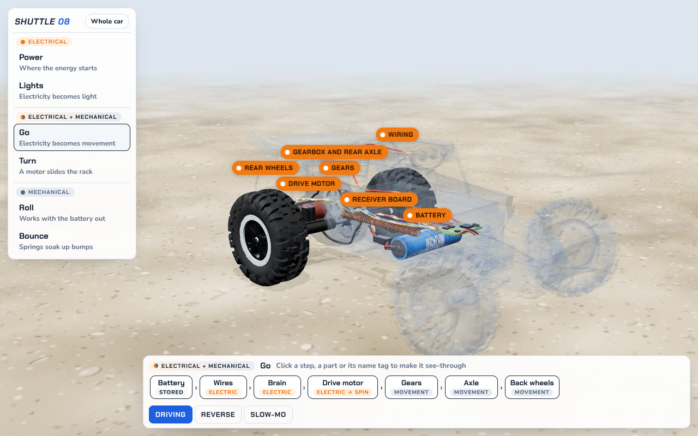
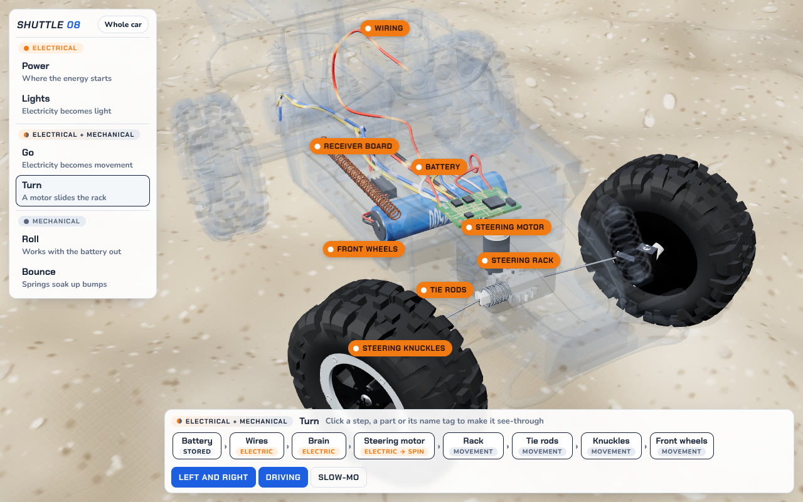
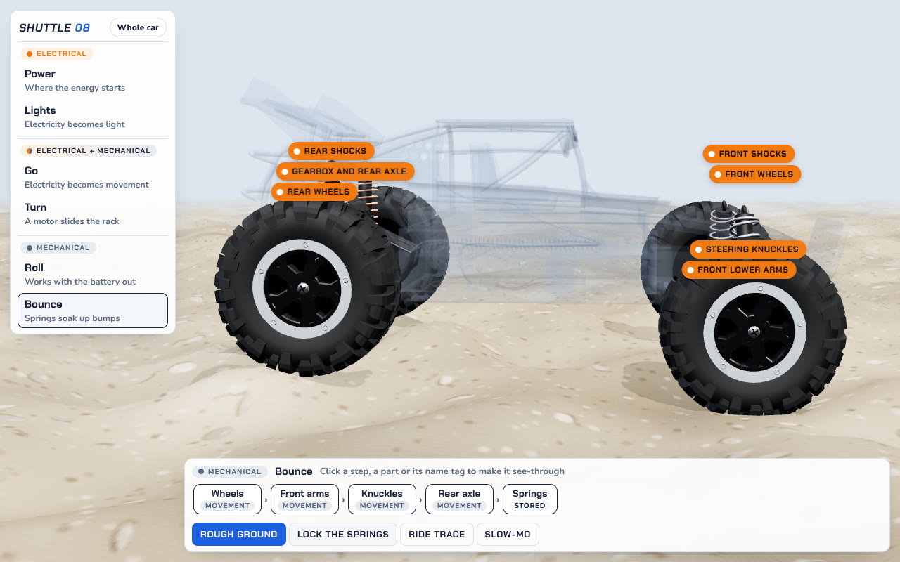
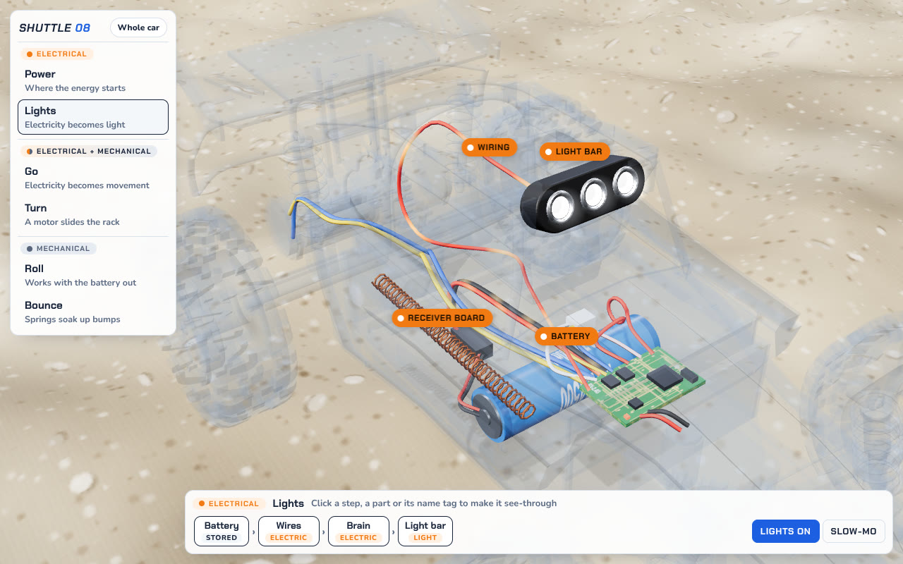
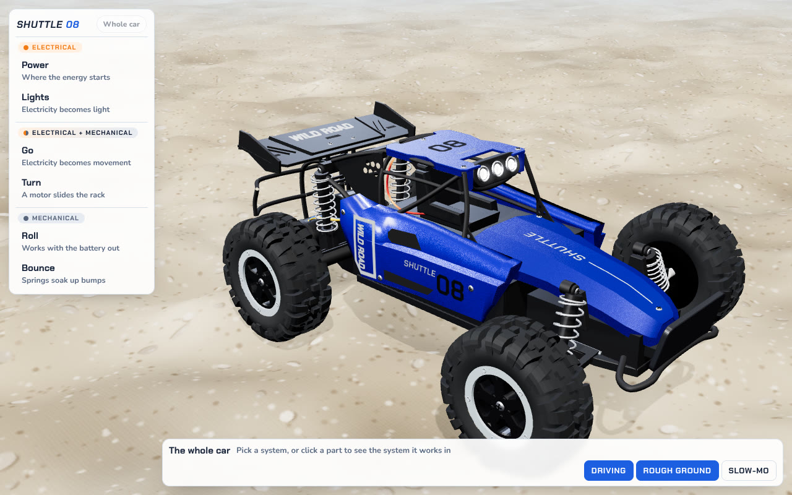
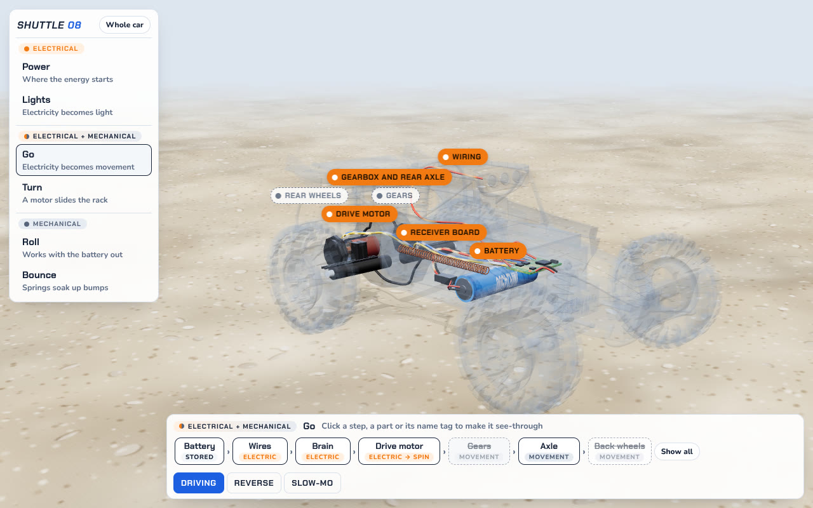

# Shuttle 08 Teardown

**See how a toy RC car turns electricity into movement.**

Shuttle 08 is an interactive 3D model of a real 1:16 toy buggy. Instead of a long list of parts, it shows the car as six *systems*: small groups of parts that work together. Pick one and the rest of the car fades to glass, the camera moves in, and you can follow the energy from the battery to the wheels.

It's made for a grown-up and a child sitting together, ideally with the real car on the table.

**Try it:** https://harell.github.io/buggy/ (once GitHub Pages is on, see [Turning on GitHub Pages](#turning-on-github-pages-once))



## Six systems, three families

Every system is sorted by what happens to the energy inside it. That sorting is the lesson.

| Family | Systems | What happens to the energy |
| --- | --- | --- |
| **Electrical** | **Power** (battery, wires, brain) and **Lights** | Electricity flows, but nothing moves. In Lights it comes out as light. |
| **Electrical + mechanical** | **Go** (battery to the back wheels, through the drive motor and gears) and **Turn** (battery to the front wheels, through the steering motor and rack) | The motor is where electricity becomes movement. |
| **Mechanical** | **Roll** (wheels, axle, gears and the motor they turn) and **Bounce** (springs, arms, rear axle, wheels) | No battery needed. Movement goes in, movement comes out. |

The app opens on **Go**, because that's the heart of it. **Whole car** shows everything solid again, and clicking any part from there opens the system it belongs to.

<table>
<tr>
<td width="50%"><br><b>Turn</b>: a small motor slides the rack, and the tie rods swing the front wheels.</td>
<td width="50%"><br><b>Bounce</b>: seen from the side, at wheel height, so you can watch the springs work.</td>
</tr>
<tr>
<td width="50%"><br><b>Lights</b>: electricity in, light out, and nothing moves.</td>
<td width="50%"><br><b>Whole car</b>: everything solid. Click a part to jump to its system.</td>
</tr>
</table>

## Follow the chain

Along the bottom, the picked system is laid out as a chain of steps, each tagged with the form its energy is in: *stored*, *electric*, *electric → spin*, *movement*.

**Want to focus on fewer parts?** Make any step see-through, in whichever way is handiest:

- click the step in the chain,
- click the part itself in 3D, or
- click its orange name tag.

Do the same again to bring it back. A see-through step turns dashed in the chain, and its tag stays, faded, so you can always click it back. **Show all** brings every step back at once. The last solid step can't be hidden, so there's always something to look at.



## Make it move

Each system brings only the buttons that matter for it:

| System | Buttons |
| --- | --- |
| Power | Motors running |
| Lights | Lights on |
| Go | Driving, Reverse |
| Turn | Left and right, Driving |
| Roll | Push it |
| Bounce | Rough ground, Lock the springs, Ride trace |

**Slow-mo** is always there. In Bounce, each spring glows orange as it's squeezed. Lock the springs to feel the difference on the same bumps. Drag to orbit, scroll to zoom, and click the system's name again to get its viewpoint back. The name tags stay still while the car drives, so they're easy to click.

### On a phone

It works on phones too, upright or on their side. The systems become a row of tabs along the top, each with its family's colour, so switching is one tap and nothing covers the car. The chain and the buttons sit below. Rows that don't fit scroll sideways and fade at the edge to show there's more. Tap instead of click, drag with one finger to orbit and pinch to zoom. The camera frames the car in the space between the tabs and the dock, and everything stays clear of the notch and the home bar.

## About the car

The model is a 1:16 toy buggy sold as the DK087 (factory no. 3699-087), in blue with its "SHUTTLE 08" and "WILD ROAD" decals. It has rear-wheel drive, a 2.4 GHz radio with on/off throttle and steering, one 3.7 V 14500 lithium-ion cell, and painted metal panels on a black plastic frame. The remote isn't shown, since the lesson is what happens inside the car. [How accurate is the model?](#how-accurate-is-the-model) says what's measured and what's a best guess.

## Run it yourself

Built with TypeScript, [Three.js](https://threejs.org/) (from npm), [Vite](https://vitejs.dev/) and [Vitest](https://vitest.dev/). Needs Node 20 or newer.

```bash
npm install       # once
npm run dev       # local dev server with hot reload
npm test          # unit tests (Vitest)
npm run typecheck # TypeScript, strict mode
npm run build     # production build into dist/
npm run preview   # serve the production build locally
```

It needs a browser with WebGL (any current Chrome, Edge, Firefox or Safari). Fonts load from Google Fonts. Everything else is bundled.

### How the code is organised

The logic that decides how the car behaves is kept free of rendering and DOM code, so it can be unit-tested. The 3D model and UI are thin layers on top.

| Folder | What lives there | Tested |
| --- | --- | --- |
| `src/core/` | Pure logic: dimensions, terrain height field, driving model, suspension, gear and rack kinematics, ride meter, label layout, parts, components (`components.ts`) and the six systems with their chains (`systems.ts`) | Yes, `tests/*.test.ts` |
| `src/model/` | Procedural 3D model: geometry builders (tested), the car's fixed mount points and outlines (`mounts.ts`, tested), materials and part registry (which component each mesh belongs to, lighting up, ghosting, cutaways, shadows), canvas textures, the car | Geometry builders, mount points and the part registry |
| `src/scene/` | Three.js scene: renderer and camera (with the shift that keeps the car clear of the systems shelf, or of the tabs and dock on a phone), the moving ground, posing the car each frame (including the spring glow) | Visually |
| `src/ui/` | DOM pieces: name tags and the ride trace | Visually |
| `src/main.ts` | Wires it all together and runs the frame loop | Visually |

New behaviour starts as a failing test in `tests/`, then the code that makes it pass.

## Builds and deploys

Two GitHub Actions workflows live in `.github/workflows/`:

| Workflow | When it runs | What it does |
| --- | --- | --- |
| `ci.yml` | Every pull request and every push to `main` | `npm ci`, typecheck, tests, production build |
| `deploy.yml` | Every push to `main` (merging a PR), or by hand from the Actions tab | Tests and builds, then publishes `dist/` to GitHub Pages. It never deploys a build whose tests fail |

`main` is the production branch: changes reach it only through pull requests.

### Turning on GitHub Pages (once)

1. In the repo, go to **Settings → Pages**.
2. Under **Build and deployment**, set **Source** to **GitHub Actions**.
3. Merge a PR into `main` (or run *Deploy to GitHub Pages* from the Actions tab). The site goes live at https://harell.github.io/buggy/.

Recommended: in **Settings → Branches**, protect `main` so that it requires a pull request and the **CI / Typecheck, test and build** check before merging.

## How accurate is the model?

The model follows online research on the real DK087 (factory no. 3699-087). [`research/README.md`](research/README.md) has the findings and sources; nobody here has the car yet.

- **Sizes:** every size is a constant in `src/core/dims.ts`, measured from buyer photos and scaled from one photo of the car on a 1 cm cutting mat. [`research/measurements.csv`](research/measurements.csv) gives each value's source and uncertainty (mostly ±1–6 mm) and the constant that uses it. The car comes out at about 22.9 × 14.2 × 9.3 cm. The seller's 24.5 × 14.5 × 9.5 cm is not a measurement. Nothing has been checked with a caliper yet.
- **Shape and parts:** taken from photos of real cars, not seller renders, and from a stock teardown video. That covers the 6 cm tyres and 5-spoke rims with a grey ring, the painted panels screwed to a moulded frame, the one lower arm per side at the front, the live rear axle with the motor lying across it, the battery bay and power switch under the car, the receiver board with its coil antenna, the 3-LED light bar and the remote.
- **Still illustrative:** the gear tooth counts and ratio (8 → 28, then 10 → 30, about 10.5 : 1), since no photo shows the gears; the steering motor, gears and rack, since the steering box was never photographed; the receiver board's chips and layout; which wire goes where; spring stiffness and travel; and the exact curves, since the car is built in code from simple shapes.
- **Checked and not used:** the first version of the model followed a [teardown of a similar 1:16 toy buggy](https://github.com/slackhappy/rccar). The DK087's own photos replace it. The Dikavey BX12, MJX 16208/16209/16210 and Traxxas 1/16–1/18 manuals describe hobby-grade 4WD cars with servos, speed controllers and differentials, not this toy.

[What still needs the car](research/README.md#still-needs-the-car) lists what to measure when it arrives: gear tooth counts, the steering box, board chips, shock travel, steering lock and weight.
